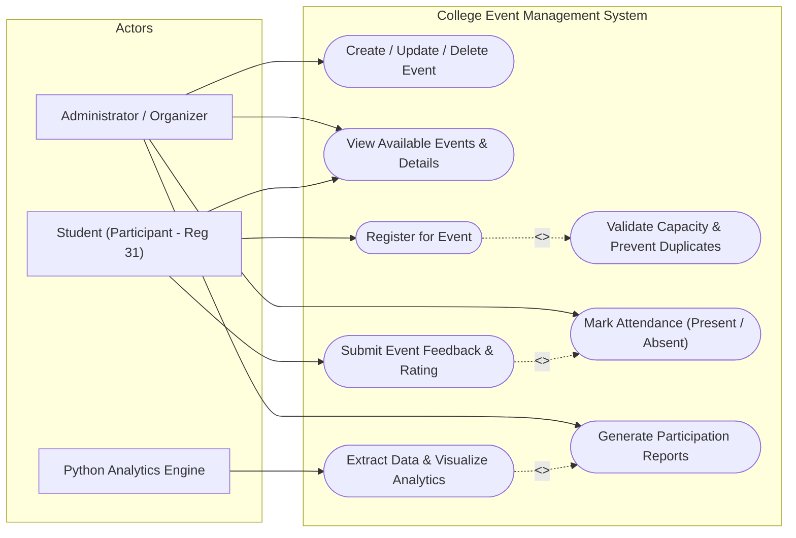
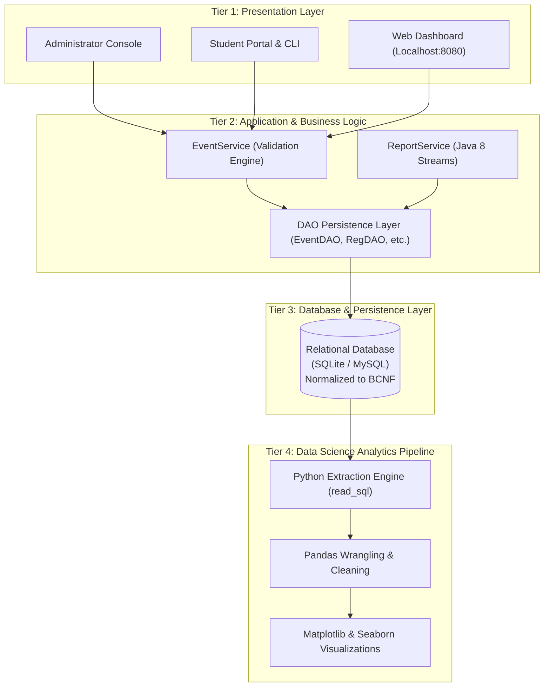
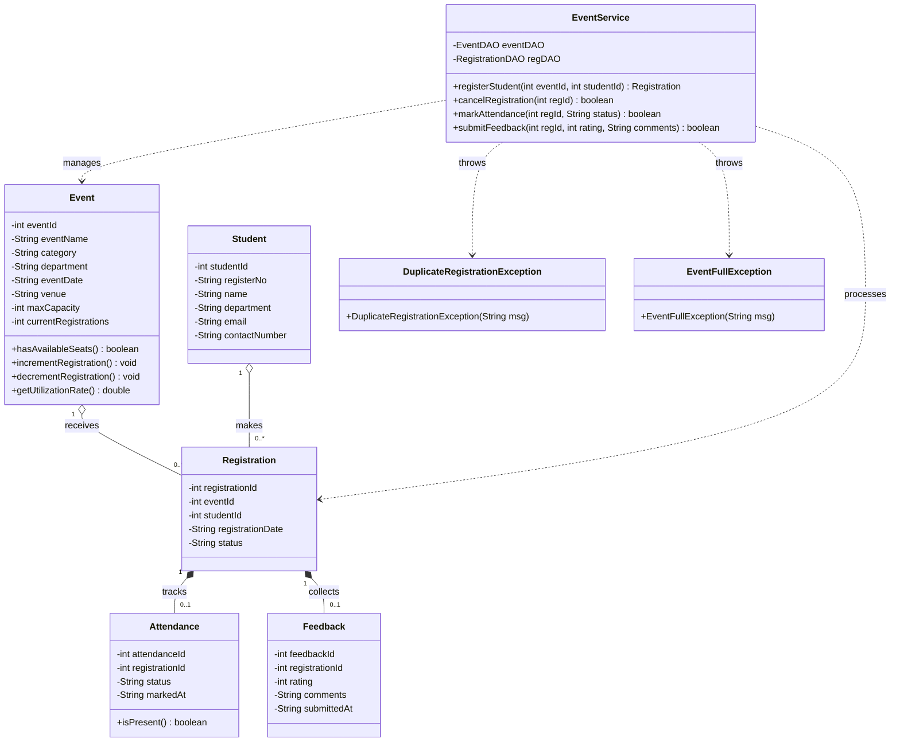
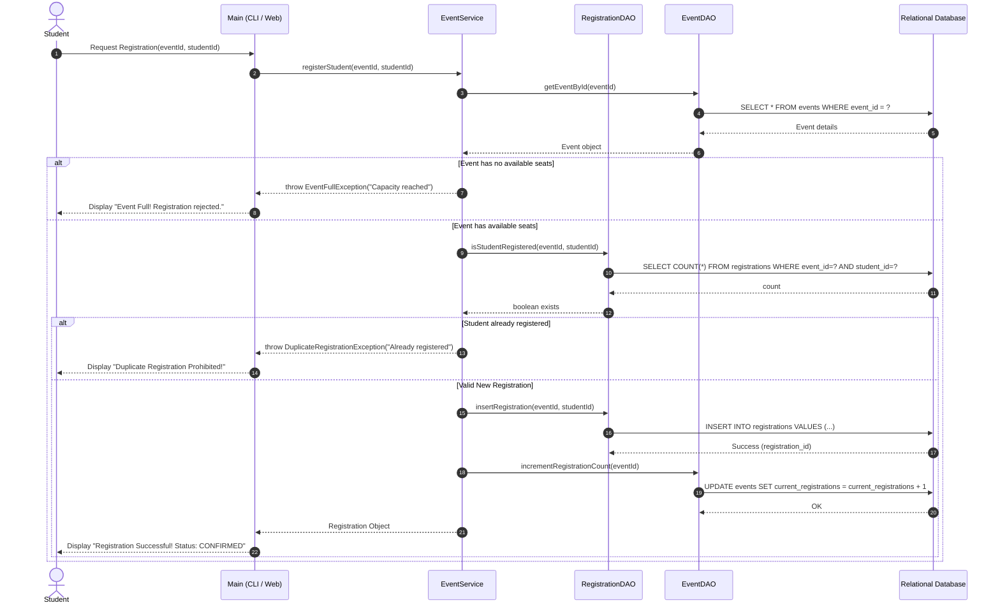
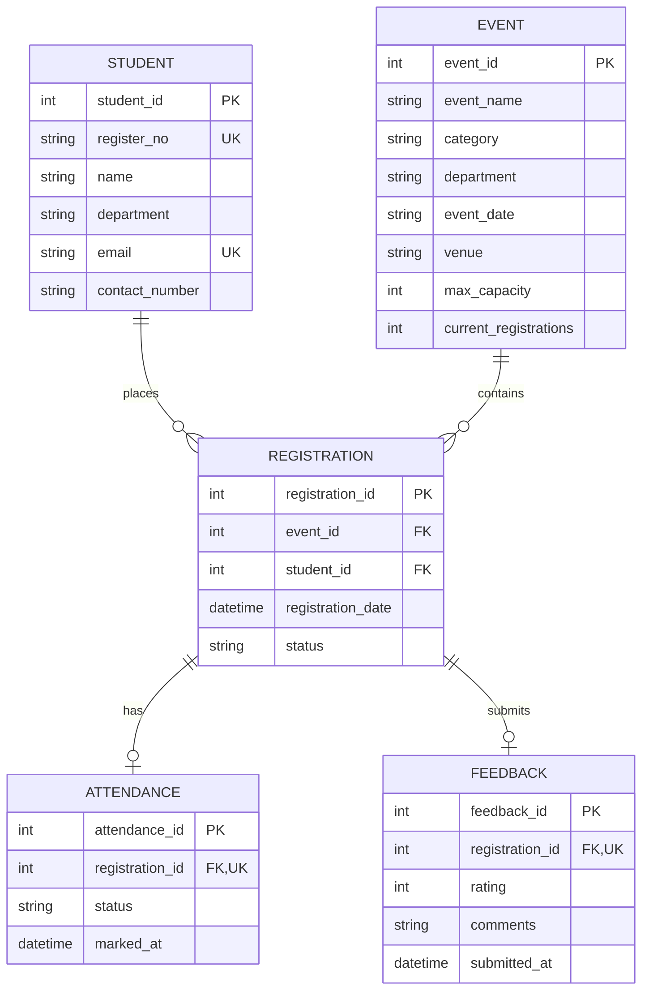

# System Design Diagrams

## College Event Management and Participation Analysis System
**Student Register No.:** 31  
**Class:** 25IT3A&B | **Course:** 25ITT33 Software Engineering & 25ITT32 Java Programming  
**Department:** Information Technology, Velalar College of Engineering and Technology  

---

## 1. Use Case Diagram

The Use Case diagram illustrates the functional interactions between the primary actors (**Administrator**, **Student**, and **Data Analyst / Python Engine**) and the system boundaries.


*Vector diagram file:* [`docs/diagrams/use_case_diagram.svg`](file:///c:/Users/madha/OneDrive/Desktop/Event%20management/docs/diagrams/use_case_diagram.svg)

---

## 2. Overall System Architecture Diagram


*Vector diagram file:* [`docs/diagrams/architecture_diagram.svg`](file:///c:/Users/madha/OneDrive/Desktop/Event%20management/docs/diagrams/architecture_diagram.svg)

---

## 3. UML Class Diagram

The Class Diagram reflects the Object-Oriented design implemented in the Java source code (`com.eventmanagement.*`), demonstrating encapsulation, inheritance, interfaces, associations, and custom exceptions.


*Vector diagram file:* [`docs/diagrams/class_diagram.svg`](file:///c:/Users/madha/OneDrive/Desktop/Event%20management/docs/diagrams/class_diagram.svg)

---

## 4. UML Component Diagram (Component-Level Design)

The Component Diagram details the internal building blocks, interfaces (`IEventService`, `IPersistenceDAO`), and physical dependencies between the presentation, service, persistence, and analytical components.

```mermaid
flowchart TD
    subgraph UIComponent [Presentation Component]
        MainApp["Main.java (Console UI)"]
        WebDash["Web Dashboard (HTML5/JS)"]
        TableRunner["Terminal Table Viewer"]
    end

    subgraph ServiceComponent [Business Service Component]
        ES["EventService.java\n(Capacity & Duplicate Logic)"]
        RS["ReportService.java\n(Java Streams Aggregator)"]
    end

    subgraph DAOComponent [Data Access Persistence Component]
        DAO_Layer["DAO Classes (EventDAO, RegDAO, etc.)"]
        DBC["DBConnection & DataStore"]
    end

    subgraph DatabaseComponent [Database Storage Component]
        SQL_DB[("SQLite 3 / MySQL Database\n(Normalized to BCNF)")]
    end

    subgraph AnalyticsComponent [Python Data Science Component]
        PY_Engine["event_analysis.py\n(Pandas / NumPy / Seaborn)"]
    end

    UIComponent -->|IEventService| ServiceComponent
    ServiceComponent -->|IPersistenceDAO| DAOComponent
    DAOComponent -->|JDBC SQL / PreparedStatement| DatabaseComponent
    DatabaseComponent -->|SQL Retrieval: read_sql()| AnalyticsComponent
```
*Vector diagram file:* [`docs/diagrams/component_diagram.svg`](file:///c:/Users/madha/OneDrive/Desktop/Event%20management/docs/diagrams/component_diagram.svg)

---

## 5. Sequence Diagram: Student Event Registration



---

## 6. Entity-Relationship (ER) Diagram


*Vector diagram file:* [`docs/diagrams/er_diagram.svg`](file:///c:/Users/madha/OneDrive/Desktop/Event%20management/docs/diagrams/er_diagram.svg)
