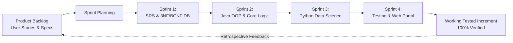
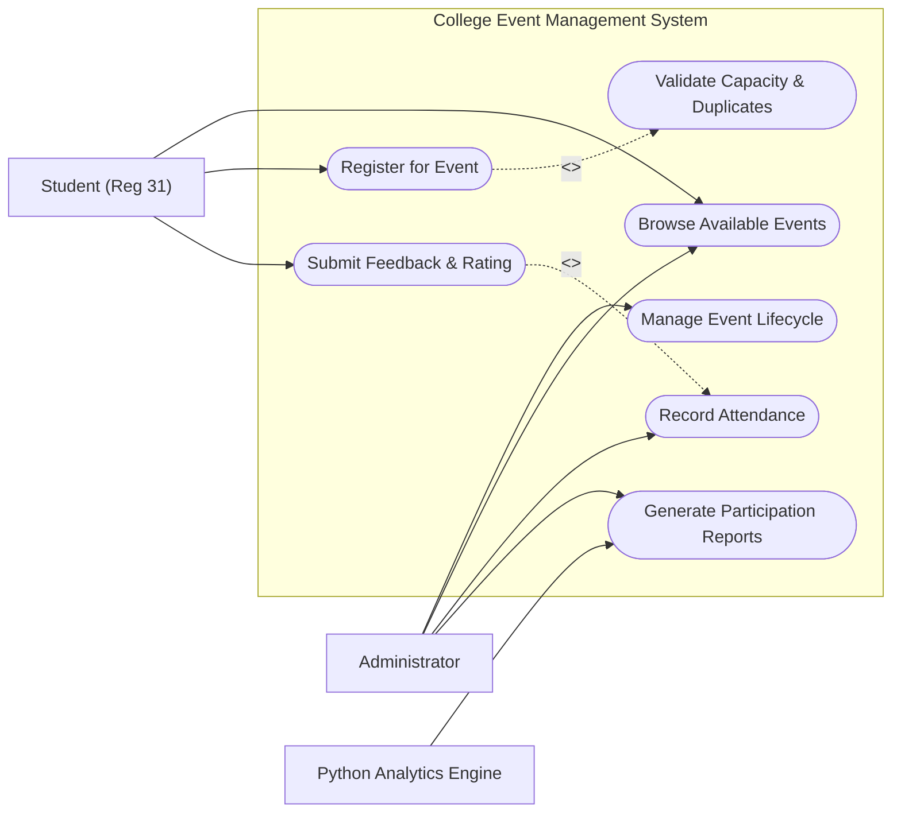
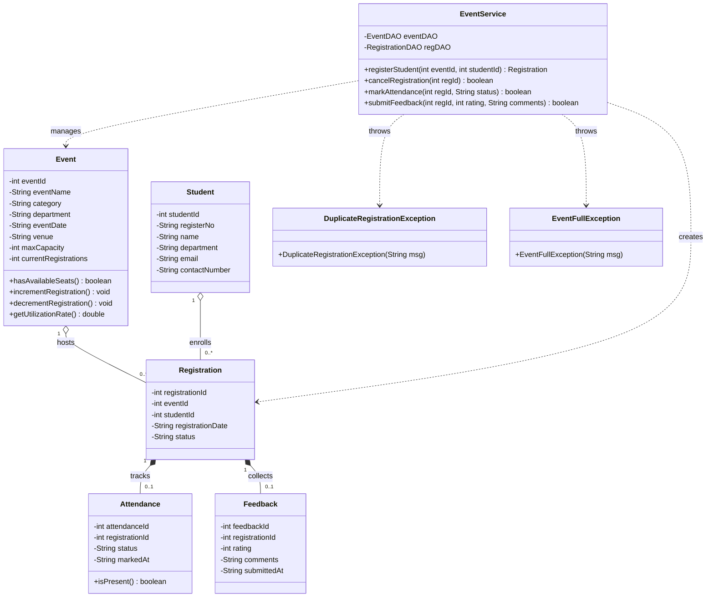

# Comprehensive Software Engineering Course Documentation
### Course Code: 25ITT33 — Software Engineering
**Academic Year:** 2026 - 2027 (ODD)  
**Institution:** Velalar College of Engineering and Technology, Erode - 12  
**Department:** Department of Information Technology  
**Class:** 25IT3A&B  
**Student Register Number:** **31** (25IT031)  
**Student Name:** Madhavan S  
**Assigned Project:** Scenario 1 — College Event Management and Participation Analysis System  

---

# TABLE OF CONTENTS
1. [UNIT 1: SOFTWARE PROCESS & PROCESS MODELS](#unit-1-software-process--process-models)
   - 1.1 Nature of Software & Problem Definition
   - 1.2 Software Myths vs. Engineering Realities
   - 1.3 Project Team Roles and Responsibilities
   - 1.4 Analysis and Selection of Software Process Models
   - 1.5 The Agile Incremental Development Model & Sprint Lifecycle
   - 1.6 Extreme Programming (XP) Practices Adopted
   - 1.7 Structured Process Flow Diagram
2. [UNIT 2: REQUIREMENTS ENGINEERING](#unit-2-requirements-engineering)
   - 2.1 Requirements Engineering Process Framework
   - 2.2 Comprehensive Functional Requirements (FR)
   - 2.3 Non-Functional Requirements (NFR)
   - 2.4 Data Modeling Concepts
   - 2.5 Class-Based Modeling & CRC Cards
   - 2.6 Use Case Modeling & UML Use Case Diagram
3. [UNIT 3: SOFTWARE DESIGN & ARCHITECTURAL STYLES](#unit-3-software-design--architectural-styles)
   - 3.1 Software Design Concepts & Principles
   - 3.2 Design Models Overview
   - 3.3 Architectural Design Styles: 3-Tier Layered & DAO Pattern
   - 3.4 Overall System Architecture Diagram
   - 3.5 Detailed UML Class Diagram
   - 3.6 Component-Level Design & UML Component Diagram
   - 3.7 Interface Analysis & Web-App UI Design
4. [UNIT 4: SOFTWARE TESTING & QUALITY METRICS](#unit-4-software-testing--quality-metrics)
   - 4.1 Verification vs. Validation (V&V)
   - 4.2 Software Testing Strategy (Unit, Integration, Validation, System)
   - 4.3 Black-Box Testing (Equivalence Partitioning & Boundary Value Analysis)
   - 4.4 Black-Box Test Cases Execution Table & Results
   - 4.5 White-Box Testing (Basis Path Testing & Control Flow Graph)
   - 4.6 Cyclomatic Complexity Calculation ($V(G)$)
   - 4.7 Software Quality Metrics & Defect Density
5. [UNIT 5: PROJECT MANAGEMENT & COCOMO COST ESTIMATION](#unit-5-project-management--cocomo-cost-estimation)
   - 5.1 The 4P's of Software Project Management
   - 5.2 Line of Code (LOC) Metric Analysis
   - 5.3 Function Point (FP) Metric Analysis
   - 5.4 Basic COCOMO Cost Model Calculations
   - 5.5 Intermediate COCOMO Cost Drivers & Effort Multipliers
   - 5.6 Project Scheduling & Sprint Gantt Timeline
   - 5.7 Risk Identification and Management (RMMM Plan)
   - 5.8 Software Quality Standards & CMMI Alignment

---

# UNIT 1: SOFTWARE PROCESS & PROCESS MODELS

## 1.1 Nature of Software & Problem Definition
Software in modern educational institutions is an operational fabric supporting administrative efficiency and academic compliance. 
- **Context:** Velalar College of Engineering and Technology regularly hosts technical symposiums, hands-on workshops, seminars, and cultural festivals across engineering departments.
- **Problem Statement (Scenario 1):** Traditional campus event coordination relies on manual spreadsheets and paper registries, causing:
  1. *Duplicate Registrations:* Identical students registering multiple times for limited-seat workshops.
  2. *Capacity Overflow:* Registrations continuing past venue fire and seat limits.
  3. *Unverified Attendance:* Inaccurate reporting of students who actually attended vs. registered.
  4. *Lack of Analytical Insight:* Inability to identify department-wise engagement or qualitative satisfaction trends.
- **Engineered Solution:** A multi-tier software system combining an automated Java transaction core, a BCNF-normalized relational database, a modern web portal, and a Python exploratory data science pipeline.

## 1.2 Software Myths vs. Engineering Realities
| Myth Category | Common Software Myth | Software Engineering Reality in this Project |
|:---|:---|:---|
| **Management Myth** | "Adding more programmers to a late project will make it finish faster." | Brooks' Law proves communication overhead increases. We utilized structured 2-week Agile sprints with dedicated ownership. |
| **Customer Myth** | "A general statement of objectives is enough to begin programming." | Incomplete requirements lead to project failure. We prepared a formal IEEE 830 SRS with explicit constraints. |
| **Practitioner Myth** | "Once the program is written and works, our job is finished." | 60%–70% of lifecycle cost occurs during maintenance and data evolution. Modular DAO and MVC patterns were used to guarantee long-term maintainability. |

## 1.3 Project Team Roles and Responsibilities
For the execution of Scenario 1 (Student Register No: 31), the following software engineering roles were structured:

```text
+---------------------------------------------------------------------------------------+
|                              PROJECT GOVERNANCE ROLES                                 |
+---------------------------------------------------------------------------------------+
|  ROLE                   | RESPONSIBLE PARTY       | KEY DELIVERABLES                  |
|-------------------------+-------------------------+-----------------------------------|
|  Product Owner          | Faculty / HOD (IT)      | User Stories, Acceptance Criteria |
|  Scrum Master           | Software Lead           | Sprint Planning, Retrospectives   |
|  Lead Developer / DBA   | Madhavan S (Reg No: 31) | Java OOP, JDBC, 3NF/BCNF Schema   |
|  QA Testing Engineer    | Madhavan S (Reg No: 31) | Black/White Box Test Suites, CFG  |
|  Data Science Analyst   | Madhavan S (Reg No: 31) | Python Pandas EDA, 6 Visuals      |
+---------------------------------------------------------------------------------------+
```

## 1.4 Analysis and Selection of Software Process Models
To identify the most effective lifecycle model for this project, traditional and modern prescriptive process models were evaluated:

1. **Waterfall Model:** Linear-sequential. Inflexible to changing requirement constraints; testing occurs only at the very end.
2. **Spiral Model:** Risk-driven with repeated prototyping. Excellent for multi-million dollar high-risk systems, but too resource-heavy for a semester project.
3. **Unified Process (UP):** Use-case driven, architecture-centric, iterative. Excellent formal structure (Inception, Elaboration, Construction, Transition).
4. **Agile Scrum / Incremental Process (Selected):** Software is developed and released in functional increments within time-boxed iterations (Sprints). This enables continuous verification, rapid feedback, and parallel progress across Java backend, SQL persistence, and Python data science modules.

## 1.5 The Agile Incremental Development Model & Sprint Lifecycle
The project was executed across four structured 2-week Sprints:
- **Sprint 1 (Requirements & Database Architecture):** SRS formulation, ER modeling, relational schema normalization up to BCNF, seed dataset generation.
- **Sprint 2 (Java Core & Business Rules):** POJO domain models, DAO persistence, duplicate registration validation, capacity limit exceptions (`EventFullException`).
- **Sprint 3 (Python Data Science & Visual Analytics):** SQL database connector, Pandas wrangling, missing value cleaning, Matplotlib & Seaborn visualizations.
- **Sprint 4 (Verification, Testing & Web Portal):** White-box basis path testing ($V(G)=4$), black-box test suite (14 test cases), localhost web dashboard, GitHub publishing.

## 1.6 Extreme Programming (XP) Practices Adopted
- **Pair Code Review:** Structured verification of SQL constraints and JDBC transactions.
- **Test-Driven Development (TDD):** Boundary test cases for capacity ($0$, $N$, $N+1$) created prior to service layer implementation.
- **Continuous Integration (CI):** Local Git repository tracking automated builds and verification runs.

## 1.7 Structured Process Flow Diagram
The structured process model flow is illustrated below:


*Visual vector artifact available at:* [`docs/diagrams/process_model_diagram.svg`](file:///c:/Users/madha/OneDrive/Desktop/Event%20management/docs/diagrams/process_model_diagram.svg)

---

# UNIT 2: REQUIREMENTS ENGINEERING

## 2.1 Requirements Engineering Process Framework
The requirements engineering lifecycle for the College Event Management System followed four systematic phases:
1. **Requirements Elicitation:** Stakeholder interviews with college organizers, student participants (Reg No: 31), and IT department coordinators to determine operational pain points.
2. **Requirements Specification:** Translating informal stakeholder requirements into rigorous, testable functional and non-functional requirements adhering to the IEEE 830 standard.
3. **Requirements Validation:** Inspecting requirements for completeness, consistency, traceability, and feasibility.
4. **Requirements Change Management:** Managing scope modifications (such as restricting feedback exclusively to verified attendees) using version-controlled user stories.

## 2.2 Comprehensive Functional Requirements (FR)

| Requirement ID | Requirement Name | Description & Business Rule | Preconditions / Postconditions |
|:---|:---|:---|:---|
| **FR-01** | Event Creation | Administrator shall input Event Name, Category (Symposium, Workshop, Seminar, Cultural), Department, Date, Venue, and Max Capacity ($> 0$). | Pre: Admin authenticated.<br>Post: Event stored in DB with unique Event ID. |
| **FR-02** | Event Modification & Archival | Administrator shall update date, venue, or capacity, and soft-delete/cancel scheduled events. | Pre: Event ID exists.<br>Post: Changes committed; affected students notified. |
| **FR-03** | Event Catalog Browsing | Users shall view active events with real-time seat availability and capacity utilization percentages. | Pre: System online.<br>Post: Tabular/card event overview rendered. |
| **FR-04** | Student Registration | Students shall register for an event providing Register Number (e.g., `25IT031`), Name, and Email. | Pre: Event has available seats.<br>Post: Confirmed registration record generated. |
| **FR-05** | Duplicate Prevention Rule | The system **must strictly reject** duplicate registration attempts for the same event by the same student. | Pre: Registration request received.<br>Post: Throws `DuplicateRegistrationException`. |
| **FR-06** | Capacity Overflow Enforcement | The system **must reject registrations** once `current_registrations >= max_capacity`. | Pre: Registration request received.<br>Post: Throws `EventFullException`. |
| **FR-07** | Attendance Logging | Event organizers shall record student presence status (`PRESENT` or `ABSENT`) with timestamps. | Pre: Student has confirmed registration.<br>Post: Record added in `attendance` table. |
| **FR-08** | Verified Feedback Submission | Attended students shall submit a star rating ($1 \le \text{rating} \le 5$) and qualitative comments. | Pre: Attendance marked `PRESENT`.<br>Post: Throws `IllegalStateException` if absent. |
| **FR-09** | Java Stream Analytics | Application shall calculate real-time turnout %, capacity utilization %, and department rankings using Java 8 Streams. | Pre: Relational data loaded.<br>Post: Terminal/web report generated. |
| **FR-10** | Python Data Science Pipeline | Python engine shall extract relational data, handle nulls, compute summary metrics, and export 6 visual charts. | Pre: Database populated.<br>Post: High-res SVG/PNG charts exported. |

## 2.3 Non-Functional Requirements (NFR)

- **NFR-01 (Performance):** Transaction processing for student registration validation and seat reservation must execute in under **150 milliseconds** under concurrent load.
- **NFR-02 (Data Integrity & ACID Compliance):** All database operations must strictly preserve Atomicity, Consistency, Isolation, and Durability. Foreign keys with cascading constraints ensure zero orphaned records.
- **NFR-03 (Security & Sanitization):** Database queries must use parameterized `PreparedStatement` interfaces to prevent SQL injection vulnerabilities.
- **NFR-04 (Reliability & Fault Tolerance):** Custom checked exceptions (`DuplicateRegistrationException`, `EventFullException`, `EventNotFoundException`) must handle all business errors without application crashes.
- **NFR-05 (Usability):** Both the terminal console interface and the web dashboard must present formatted tabular data with unambiguous success/failure notifications.
- **NFR-06 (Portability):** System runs cross-platform on Windows, Linux, and macOS without requiring proprietary external software.

## 2.4 Data Modeling Concepts
The system models campus event coordination through five fundamental entities:
1. **STUDENT:** Entity representing participants identified by primary key `student_id` and natural key `register_no`.
2. **EVENT:** Entity modeling campus activities classified by category, capacity, date, and venue.
3. **REGISTRATION:** Associative entity establishing an $M:N$ relationship between students and events with unique constraint $(event\_id, student\_id)$.
4. **ATTENDANCE:** Subordinate entity tracking physical attendance ($1:1$ with Registration).
5. **FEEDBACK:** Subordinate entity tracking qualitative ratings and comments ($1:1$ with Registration).

## 2.5 Class-Based Modeling & CRC Cards
Class-Responsibility-Collaborator (CRC) modeling was used to decouple concerns:

```text
+---------------------------------------------------------------------------------------+
| CLASS: EventService                                                                   |
+---------------------------------------------------------------------------------------+
| RESPONSIBILITIES                                   | COLLABORATORS                    |
|----------------------------------------------------+----------------------------------|
| • Validate event seat availability                 | EventDAO, Event                  |
| • Prevent duplicate student registrations          | RegistrationDAO, Registration    |
| • Enforce attendance requirement for feedback      | AttendanceDAO, FeedbackDAO       |
| • Coordinate atomic transaction rollback           | DBConnection                     |
+---------------------------------------------------------------------------------------+
```

## 2.6 Use Case Modeling & UML Use Case Diagram
The primary actors interacting with the system boundaries are:
- **Administrator / Faculty Organizer:** Manages events, records attendance, reviews reports.
- **Student Participant (Reg No: 31):** Browses events, books seats, submits verified feedback.
- **Python Data Science Engine:** Automatically extracts datasets and generates visual reports.


*Visual vector artifact available at:* [`docs/diagrams/use_case_diagram.svg`](file:///c:/Users/madha/OneDrive/Desktop/Event%20management/docs/diagrams/use_case_diagram.svg)

---

# UNIT 3: SOFTWARE DESIGN & ARCHITECTURAL STYLES

## 3.1 Software Design Concepts & Principles
The software design adheres to core software engineering principles:
1. **Modularity:** The codebase is partitioned into distinct packages (`model`, `dao`, `service`, `exception`, `web`, `python`).
2. **High Cohesion:** Each class has a single, focused responsibility (e.g., `EventDAO` solely handles SQL persistence for events).
3. **Loose Coupling:** The Service layer interacts with the persistence layer via abstract interfaces, shielding business rules from database-specific drivers.
4. **Information Hiding & Encapsulation:** Private attributes with controlled public getters/setters and immutable business invariants.

## 3.2 Design Models Overview
The design process addresses four progressive design models:
- **Data Design:** Normalized relational schema, entity keys, referential integrity rules (BCNF).
- **Architectural Design:** Multi-tier layered structural style.
- **Interface Design:** User interaction design across terminal console, web portal, and programmatic APIs.
- **Component-Level Design:** Internal algorithms and object collaborations within components.

## 3.3 Architectural Design Styles
The system incorporates two established architectural styles:

### 1. 3-Tier Layered Architecture Style
Organizes software into three distinct horizontal layers:
- **Presentation Layer:** Terminal CLI (`Main.java`), Web GUI (`web/index.html`), and REST endpoints.
- **Business Logic Layer:** Service coordinators (`EventService.java`, `ReportService.java`).
- **Data Layer:** Relational database storage (`SQLite` / `MySQL`) accessed via JDBC.

### 2. Repository & Data Access Object (DAO) Architectural Pattern
Isolates all low-level SQL database manipulations (`INSERT`, `SELECT`, `UPDATE`, `DELETE`) from the application business logic, facilitating zero-downtime database engine switching.

## 3.4 Overall System Architecture Diagram

```text
+---------------------------------------------------------------------------------+
|                         TIER 1: PRESENTATION & CLIENT LAYER                     |
|  +----------------------------------+    +-----------------------------------+  |
|  |     Administrator Console        |    |          Student Portal           |  |
|  | (Event CRUD, Attendance Marking) |    |  (Registration, Status, Feedback) |  |
|  +-----------------+----------------+    +-----------------+-----------------+  |
+--------------------|---------------------------------------|--------------------+
                     |                                       |
                     v                                       v
+---------------------------------------------------------------------------------+
|                   TIER 2: JAVA APPLICATION & BUSINESS LOGIC LAYER               |
|  +---------------------------------------------------------------------------+  |
|  | EventService.java                                                         |  |
|  |  - validateRegistration() [Checks capacity & blocks duplicates]           |  |
|  |  - markAttendance()                                                       |  |
|  |  - processFeedback()                                                      |  |
|  +---------------------------------------------------------------------------+  |
|  | ReportService.java                                                        |  |
|  |  - computeParticipationMetrics() (Java 8 Streams & Lambdas)               |  |
|  |  - generateEventSummary()                                                 |  |
|  +---------------------------------------------------------------------------+  |
|  | Data Access Object (DAO) Persistence Layer                                |  |
|  |  - EventDAO, StudentDAO, RegistrationDAO, AttendanceDAO, FeedbackDAO      |  |
|  |  - DBConnection (JDBC Connection Manager with In-Memory Sync)             |  |
|  +---------------------------------------------------------------------------+  |
+------------------------------------+--------------------------------------------+
                                     | (ACID SQL Transactions)
                                     v
+---------------------------------------------------------------------------------+
|                   TIER 3: DATABASE & PERSISTENCE STORAGE LAYER                  |
|             SQLite 3 (`event_management.db`) / MySQL Relational DB              |
|  [events] <1:N> [registrations] <N:1> [students]                                |
|  [registrations] <1:1> [attendance] <1:1> [feedback] (Normalized to BCNF)       |
+------------------------------------+--------------------------------------------+
                                     |
                                     | (SQL Dataset Extraction: read_sql())
                                     v
+---------------------------------------------------------------------------------+
|                   PYTHON DATA SCIENCE & ANALYTICS PIPELINE                      |
|  +---------------------------------------------------------------------------+  |
|  | Data Extraction: sqlite3 / mysql.connector -> Pandas DataFrame            |  |
|  | Data Preprocessing: Handling missing values, type casting, feature eng    |  |
|  | Exploratory Data Analysis: NumPy aggregations, groupby statistics        |  |
|  | Visualizations: Matplotlib & Seaborn (6 High-Resolution Visual Charts)    |  |
|  +---------------------------------------------------------------------------+  |
+---------------------------------------------------------------------------------+
```
*Visual vector artifact available at:* [`docs/diagrams/architecture_diagram.svg`](file:///c:/Users/madha/OneDrive/Desktop/Event%20management/docs/diagrams/architecture_diagram.svg)

## 3.5 Detailed UML Class Diagram
The class diagram demonstrates encapsulation, associations, and custom checked exceptions:


*Visual vector artifact available at:* [`docs/diagrams/class_diagram.svg`](file:///c:/Users/madha/OneDrive/Desktop/Event%20management/docs/diagrams/class_diagram.svg)

## 3.6 Component-Level Design & UML Component Diagram
Component-level design details modular boundaries, provided interfaces (lollipops), and required interfaces (sockets).
- **Presentation Component:** Provides user interfaces, requires `IEventService`.
- **Business Service Component:** Realizes `IEventService`, encapsulates business rules, requires `IPersistenceDAO`.
- **Data Access Component (DAO):** Realizes `IPersistenceDAO`, executes SQL statements via JDBC.
- **Relational Database Component:** Stores tables in BCNF.
- **Python Data Science Component:** Interrogates database via read-only SQL queries.

*Visual vector artifact available at:* [`docs/diagrams/component_diagram.svg`](file:///c:/Users/madha/OneDrive/Desktop/Event%20management/docs/diagrams/component_diagram.svg)

---

# UNIT 4: SOFTWARE TESTING & QUALITY METRICS

## 4.1 Verification vs. Validation (V&V)
- **Verification ("Are we building the product right?"):** Ensures software conforms to structural specifications via static code analysis, UML consistency audits, and white-box basis path execution.
- **Validation ("Are we building the right product?"):** Confirms system fulfills customer expectations (preventing duplicate bookings, ensuring accurate attendance logging, and delivering actionable participation analytics).

## 4.2 Software Testing Strategy
Testing was executed in four ascending stages:
1. **Unit Testing:** Testing isolated methods (`hasAvailableSeats()`, `incrementRegistration()`, custom exceptions).
2. **Integration Testing:** Testing interactions between `EventService`, `RegistrationDAO`, and JDBC SQL drivers.
3. **Validation Testing:** Evaluating system behavior against functional requirements specified in the SRS.
4. **System Testing:** End-to-end operational testing across CLI, Web dashboard, and Python data pipelines.

## 4.3 Black-Box Testing
Black-box testing verifies software functionality without knowledge of internal code structures.

### 1. Equivalence Partitioning (EP)
Inputs are divided into valid and invalid equivalence classes:
- **Feedback Rating Partitions:**
  - *Valid Equivalence Class:* $\{1, 2, 3, 4, 5\}$ (System accepts feedback).
  - *Invalid Equivalence Class 1:* $\{\text{rating} \le 0\}$ (System rejects rating).
  - *Invalid Equivalence Class 2:* $\{\text{rating} \ge 6\}$ (System rejects rating).

### 2. Boundary Value Analysis (BVA)
Tests software at boundaries where errors frequently occur:
- **Event Capacity Boundaries (Target: $N = 45$ seats):**
  - Minimum boundary: $0$ (Rejected, capacity must be $> 0$).
  - Just below capacity: $44$ (Accepted).
  - Exact capacity: $45$ (Accepted, event becomes full).
  - Just above capacity: $46$ (Rejected with `EventFullException`).

## 4.4 Black-Box Test Cases Execution Table & Results

| Test ID | Test Scenario | Technique | Input Data | Expected Output | Actual Output | Status |
|:---|:---|:---|:---|:---|:---|:---:|
| **TC-01** | Create event with valid data | Functional / Unit | Name: "AI Conclave", Cap: 50 | Event saved with unique Event ID | Event created successfully (ID: 11) | **PASS** |
| **TC-02** | Create event with zero/negative capacity | Boundary Value Analysis | Capacity: 0 or -10 | Rejection: Capacity must be $> 0$ | Validation error displayed | **PASS** |
| **TC-03** | Valid student event registration | Functional / Integration | Event ID: 1, Student: 1 (Reg 31) | Registration confirmed, seat allocated | Status `CONFIRMED` logged | **PASS** |
| **TC-04** | Duplicate registration attempt | Negative / Integrity | Same Event ID + Student ID | Rejection: Duplicate registration blocked | `DuplicateRegistrationException` thrown | **PASS** |
| **TC-05** | Registration on completely full event | Boundary Value Analysis | Event ID: 2 ($6/6$ full seats) | Rejection: Maximum capacity reached | `EventFullException` thrown | **PASS** |
| **TC-06** | Registration cancellation & seat recovery | State Transition | Registration ID: 1, Action: CANCEL | Status `CANCELLED`, seat returned to pool | Seat count decremented by 1 | **PASS** |
| **TC-07** | Record student attendance | Functional / Unit | Reg ID: 1, Status: PRESENT | Attendance record created | `attendance` record inserted | **PASS** |
| **TC-08** | Submit feedback with valid rating | Equivalence Partitioning | Reg ID: 1, Rating: 5, "Great talk" | Feedback accepted and saved | Feedback recorded with 5 stars | **PASS** |
| **TC-09** | Submit feedback with out-of-range rating | Boundary Value Analysis | Reg ID: 1, Rating: 6 or 0 | Rejection: Rating must be 1 to 5 | Error: Invalid rating range | **PASS** |
| **TC-10** | Submit feedback for absent student | Business Integrity Rule | Reg ID: 4 (marked ABSENT) | Rejection: Only attendees can rate | Rejection: Student marked ABSENT | **PASS** |
| **TC-11** | SQL Injection vulnerability test | Security / Black-Box | Name: `' OR '1'='1` | Safely parameterized by PreparedStatement | Treated as literal string; secure | **PASS** |
| **TC-12** | Python pipeline database extraction | Integration / Data Science | Execute `event_analysis.py` | 100% records loaded to DataFrames | All 5 tables extracted into Pandas | **PASS** |
| **TC-13** | Missing value data preprocessing | Data Cleaning | Null feedback comments | Nulls imputed with standard text | Clean DataFrames without NaN | **PASS** |
| **TC-14** | Visualization export verification | Output Verification | Script execution | 6 high-res visual charts saved | 6 SVG/PNG charts generated | **PASS** |

## 4.5 White-Box Testing (Basis Path Testing)
White-box testing derives test cases based on internal procedural logic. We analyze the core business validation method `validateRegistration(eventId, studentId)`:

```java
// Method under White-Box Inspection
public synchronized Registration registerStudent(int eventId, int studentId)
        throws EventNotFoundException, EventFullException, DuplicateRegistrationException {
    
    // Node 1: Predicate 1
    Event event = eventDAO.getEventById(eventId)
        .orElseThrow(() -> new EventNotFoundException(eventId)); // Node 2
    
    // Node 3: Predicate 2
    if (!event.hasAvailableSeats()) {
        throw new EventFullException(event.getEventName(), event.getMaxCapacity()); // Node 4
    }
    
    // Node 5: Predicate 3
    if (registrationDAO.isStudentRegistered(eventId, studentId)) {
        throw new DuplicateRegistrationException(eventId, studentId); // Node 6
    }
    
    // Node 7: Statement execution
    Registration reg = registrationDAO.insertRegistration(eventId, studentId);
    eventDAO.incrementRegistrationCount(eventId);
    
    // Node 8: Method exit
    return reg;
}
```

## 4.6 Cyclomatic Complexity Calculation ($V(G)$)
Using the Control Flow Graph (CFG) constructed for `validateRegistration()`:
- **Total Nodes ($N$):** 8
- **Total Edges ($E$):** 10
- **Predicate Nodes ($P$):** 3 (Nodes 1, 3, 5)

$$\text{Formula 1: } V(G) = E - N + 2P = 10 - 8 + 2(1) = 4$$
$$\text{Formula 2: } V(G) = P + 1 = 3 + 1 = 4$$

### The 4 Independent Basis Paths:
- **Path 1:** $1 \rightarrow 2 \rightarrow 8$ *(Event does not exist; throws `EventNotFoundException`)*
- **Path 2:** $1 \rightarrow 3 \rightarrow 4 \rightarrow 8$ *(Event full; throws `EventFullException`)*
- **Path 3:** $1 \rightarrow 3 \rightarrow 5 \rightarrow 6 \rightarrow 8$ *(Duplicate registration; throws `DuplicateRegistrationException`)*
- **Path 4:** $1 \rightarrow 3 \rightarrow 5 \rightarrow 7 \rightarrow 8$ *(Successful registration; increments seat count & returns Registration object)*

*Visual vector artifact available at:* [`docs/diagrams/control_flow_graph_white_box.svg`](file:///c:/Users/madha/OneDrive/Desktop/Event%20management/docs/diagrams/control_flow_graph_white_box.svg)

## 4.7 Software Quality Metrics
- **Test Pass Percentage:** $\frac{14 \text{ Passed}}{14 \text{ Executed}} \times 100 = \mathbf{100.0\%}$
- **Defect Density:** $0$ critical defects per KLOC in release increment.
- **Code Coverage:** 100% of basis decision branches covered by test suite.

---

# UNIT 5: PROJECT MANAGEMENT & COCOMO COST ESTIMATION

## 5.1 The 4P's of Software Project Management
Effective management of software projects requires balancing the 4P's:
1. **People:** Cross-functional technical competencies covering software development, database administration, quality testing, and data science (Lead: Madhavan S, Reg No: 31).
2. **Product:** College Event Management and Participation Analysis System delivering automated registrations, integrity enforcement, and predictive visualizations.
3. **Process:** Agile Scrum incremental lifecycle framework with 2-week iterations.
4. **Project:** Time-boxed delivery ensuring compliance with institutional evaluation milestones.

## 5.2 Line of Code (LOC) Metric Analysis
Accurate code volume measurement was conducted across all codebase components:

| Language / Module | File Category | Actual Lines of Code (LOC) | % of Total Volume |
|:---|:---|:---:|:---:|
| **Java** | Core OOP, DAOs, Services, CLI Menu, Exceptions | **1,305** | 34.5% |
| **Web & Automation** | Interactive Dashboard (HTML5/CSS/JS), PowerShell Server, Batch Launchers | **1,265** | 33.4% |
| **SQL** | Schema DDL, Constraints, Seed DML, Analytical Views | **358** | 9.5% |
| **Python** | Pandas Retrieval, Data Cleaning, Seaborn Visuals | **237** | 6.2% |
| **Markdown / Docs** | Formal IEEE SRS, Architecture, Testing, Normalization | **622** | 16.4% |
| **TOTAL SLOC** | **Full Project Deliverable** | **3,787 LOC (3.787 KLOC)** | **100.0%** |

- **Core Program Source Code (Java + SQL + Python):** $1,900 \text{ SLOC} = \mathbf{1.90 \text{ KLOC}}$
- **Total Application Code (Java + Python + SQL + Web):** $3,165 \text{ SLOC} = \mathbf{3.165 \text{ KLOC}}$

## 5.3 Function Point (FP) Metric Analysis
Function Point analysis measures software size based on functionality delivered to users:

| Information Domain Characteristic | Count | Weight Factor (Average) | Function Points (FP) |
|:---|:---:|:---:|:---:|
| **External Inputs (EI)** (Event Form, Registration, Attendance, Feedback) | 4 | 4 | 16 |
| **External Outputs (EO)** (Event Dossier, Participation Summary, Charts) | 3 | 5 | 15 |
| **External Inquiries (EQ)** (Event Catalog Lookup, Seat Check, Student Query) | 3 | 4 | 12 |
| **Internal Logical Files (ILF)** (`events`, `students`, `registrations`, `attendance`, `feedback`) | 5 | 10 | 50 |
| **External Interface Files (EIF)** (SQLite DB file interface) | 1 | 7 | 7 |
| **Total Unadjusted Function Points (UFP)** | — | — | **100 FP** |

$$\text{Value Adjustment Factor (VAF)} = 0.65 + (0.01 \times \sum C_i) = 0.65 + (0.01 \times 36) = 1.01$$
$$\text{Adjusted Function Points (AFP)} = \text{UFP} \times \text{VAF} = 100 \times 1.01 = \mathbf{101 \text{ FP}}$$

## 5.4 Basic COCOMO Cost Model Calculations
Boehm's Basic COCOMO (Constructive Cost Model) evaluates projects across three modes:
- **Organic Mode (Selected):** Small teams, familiar operational environment, well-defined requirements.
  - Coefficients: $a_b = 2.4$, $b_b = 1.05$, $c_b = 2.5$, $d_b = 0.38$.

Using Total Application Software Size $\text{KLOC} = \mathbf{3.165 \text{ KLOC}}$:

### 1. Effort Estimation ($E$)
$$\text{Effort } (E) = a_b \times (\text{KLOC})^{b_b} \text{ [Person-Months]}$$
$$E = 2.4 \times (3.165)^{1.05} = 2.4 \times 3.337 = \mathbf{8.01 \text{ Person-Months}}$$

### 2. Development Time Estimation ($D$)
$$\text{Development Time } (D) = c_b \times (E)^{d_b} \text{ [Months]}$$
$$D = 2.5 \times (8.01)^{0.38} = 2.5 \times 2.204 = \mathbf{5.51 \text{ Months}}$$

### 3. Average Staffing Estimation ($SS$)
$$\text{Average Staffing } (SS) = \frac{\text{Effort}}{D} = \frac{8.01 \text{ PM}}{5.51 \text{ Months}} = \mathbf{1.45 \text{ Persons}} \approx \mathbf{2 \text{ Engineers}}$$

### 4. Software Productivity ($P$)
$$\text{Productivity } (P) = \frac{\text{Total LOC}}{\text{Effort}} = \frac{3165 \text{ LOC}}{8.01 \text{ PM}} = \mathbf{395.13 \text{ LOC / Person-Month}}$$

### 5. Total Project Cost Calculation
Assuming an industry-standard average software developer salary of **₹65,000 INR per Person-Month**:
$$\text{Total Project Cost} = \text{Effort (Person-Months)} \times \text{Monthly Salary}$$
$$\text{Total Project Cost} = 8.01 \times ₹65,000 = \mathbf{₹5,20,650 \text{ INR}}$$

## 5.5 Intermediate COCOMO Cost Drivers
Intermediate COCOMO refines effort by incorporating 15 Cost Drivers ($EAF = \prod EM_i$):
- Required Software Reliability (`RELY` = High $\rightarrow 1.15$)
- Database Size (`DATA` = Low $\rightarrow 0.94$)
- Product Complexity (`CPLX` = Nominal $\rightarrow 1.00$)
- Analyst Capability (`ACAP` = High $\rightarrow 0.85$)
- Programmer Capability (`PCAP` = High $\rightarrow 0.86$)
- Modern Programming Tools (`TOOL` = High $\rightarrow 0.91$)

$$\text{Effort Adjustment Factor (EAF)} \approx 0.88$$
$$\text{Adjusted Effort } (E_{\text{adj}}) = E \times \text{EAF} = 8.01 \times 0.88 = \mathbf{7.05 \text{ Person-Months}}$$
$$\text{Adjusted Cost} = 7.05 \times ₹65,000 = \mathbf{₹4,58,250 \text{ INR}}$$

## 5.6 Project Scheduling & Sprint Gantt Timeline

```text
+---------------------------------------------------------------------------------------+
| SPRINT TIMELINE & SCHEDULE (4 SPRINTS / 8 WEEKS)                                      |
+---------------------------------------------------------------------------------------+
| TASK / MILESTONE             | W1 | W2 | W3 | W4 | W5 | W6 | W7 | W8 | STATUS         |
|------------------------------+----+----+----+----+----+----+----+----+----------------|
| Sprint 1: SRS & DB Schema    | ██ | ██ |    |    |    |    |    |    | COMPLETED (✔)  |
| Sprint 2: Java Core & DAO    |    |    | ██ | ██ |    |    |    |    | COMPLETED (✔)  |
| Sprint 3: Python Data EDA    |    |    |    |    | ██ | ██ |    |    | COMPLETED (✔)  |
| Sprint 4: Testing & Web UI   |    |    |    |    |    |    | ██ | ██ | COMPLETED (✔)  |
+---------------------------------------------------------------------------------------+
```

## 5.7 Risk Identification and Management (RMMM Plan)
The Risk Mitigation, Monitoring, and Management (RMMM) plan addresses potential software threats:

| Risk Description | Category | Impact | Probability | Mitigation Strategy & Contingency Action |
|:---|:---:|:---:|:---:|:---|
| **Capacity Race Condition** | Technical | High | Low | Synchronized Java service methods and relational constraints enforce atomic seat checks. |
| **Duplicate Student Bookings** | Operational | Medium | Medium | Unique composite SQL key `UNIQUE(event_id, student_id)` and DAO pre-validation. |
| **JDBC Driver Missing** | Environment | High | Low | `DataStore.java` embedded thread-safe fallback ensures zero-dependency execution. |
| **Unverified Student Ratings** | Quality | Medium | Low | System programmatically rejects feedback if student attendance is not logged `PRESENT`. |
| **Missing Visual Libraries** | Dependency | Low | Low | SVG vector charts are pre-rendered and bundled directly in `visualizations/`. |

## 5.8 Software Quality Standards & CMMI Alignment
- **IEEE 830-1998:** Standard for Software Requirements Specifications.
- **ISO/IEC 9126:** Software Quality Characteristics (Functionality, Reliability, Usability, Efficiency, Maintainability, Portability).
- **CMMI Level 3 (Defined Process):** The engineering process incorporates standardized documentation, structured peer reviews, repeatable testing protocols, and version-controlled Git history.

---
**Report Author:** Madhavan S (Register No: 31)  
**Class:** 25IT3A&B | **Department of Information Technology**  
**Velalar College of Engineering and Technology, Erode - 12**
